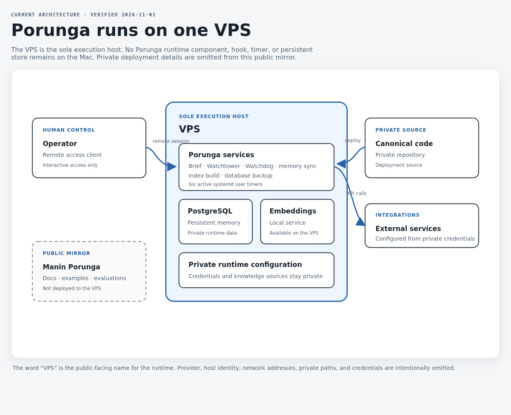

<p align="center">
  
</p>

<h1 align="center">Manin Porunga</h1>

<p align="center">
  <a href="https://github.com/ibhugeloo/manin-porunga/actions/workflows/evals.yml"></a>
</p>

<p align="center">
  &nbsp;&nbsp;
  &nbsp;&nbsp;
  &nbsp;&nbsp;
  &nbsp;&nbsp;
  &nbsp;&nbsp;
  
</p>

<p align="center">
  <strong>A VPS-based personal AI control room — private memory, model diversity, eval-tested guardrails, and gated delivery.</strong><br />
  Porunga runs on one VPS. This public repository is a curated mirror, not the deployment source.
</p>

<p align="center">
  <sub>Curated public mirror of a private system. Kept deliberately
  dense — only the pieces worth reading: the <a href="#evaluation">CI-gated eval harness</a>,
  the <a href="#notable-delivery-contract--gating">notable delivery gate</a>, the
  <a href="#showcase-semantic-vault-search">offline retrieval demo</a>, the
  operating doctrine, and the mechanical guardrails.</sub>
</p>

<p align="center">
  <sub>A worked example of context engineering, multi-agent orchestration, LLMOps, and LLM evals.
  See <a href="#what-this-demonstrates-engineering">what this demonstrates</a>.</sub>
</p>

---

## Why

The interesting part of a personal AI system is **where it runs, where its memory lives,
and which source wins when copies disagree**. Porunga's production runtime now lives on one
VPS. There are no Porunga runtime components, hooks, timers, or persistent stores on the
Mac; a computer used to connect is only an access client.

The private Porunga repository and private knowledge base remain the sources of truth. This
repository is a sanitized public mirror with examples, guardrail scripts, and evaluation
fixtures. It is not pulled by the VPS and must not be treated as the production deployment
source. Notion is an archive for selected machine outputs, not an authority for code or doctrine.

See the [current architecture and timer inventory](docs/architecture.md).

<p align="center">
  <a href="docs/assets/setup-map.html"></a>
</p>

## What this demonstrates (engineering)

> What each part of this system *is*, in the vocabulary of building production AI systems —
> the same competencies engineering teams evaluate for.

| Component in this repo | AI-engineering competency |
|---|---|
| Tiered **HOT / WARM / COLD** memory + **path-scoped rules** + **cross-harness bridges** ([`AGENTS.md`](./AGENTS.md)) | **Context engineering** — managing token budget deliberately instead of dumping everything in. The public mirror shows portable doctrine and examples; private runtime wiring stays private. |
| **Offline retrieval demo** ([`showcase/semantic-vault-search/`](./showcase/semantic-vault-search/)) + **Post-RAG architectural pivot** | **Retrieval / RAG** — this repository preserves a runnable hybrid retrieval prototype. Current production retrieval uses structured indexes and deterministic lexical search; the demo is not a VPS service. |
| Multi-agent roles across different model families | **Multi-agent orchestration** — the doctrine shows how independent agents can challenge one another. This public mirror does not describe private client, model, or provider wiring. |
| **Notable Delivery Contract** ([`bin/jarvis-ship-check.py`](./bin/jarvis-ship-check.py)) | **Delivery engineering & QA** — moving beyond "it compiles": pre-code hypothesis audits, vertical observable slices with verifiable E2E proof, and independent review in fresh context before calling a feature "ready". |
| Doctrine evaluation harness ([`tests/doctrine/`](./tests/doctrine)) | **LLM evaluation** — assistant behaviour tested against 14 scenarios across 6 categories, not assumed correct: weighted scoring, category aggregation, **regression detection vs previous run**, non-zero exit gating CI. |
| VPS-only background runtime + deterministic token observability ([`bin/jarvis-token-report`](./bin/jarvis-token-report), reference script) | **LLMOps & cost control** — background work runs from the VPS; token reporting code in this mirror is an example, not a live service. |
| PreToolUse hooks, sequential state ops, memory boundaries ([`bin/jarvis-bash-guard.sh`](./bin/jarvis-bash-guard.sh), [`bin/jarvis-memory-guard.sh`](./bin/jarvis-memory-guard.sh)) | **AI safety & reliability** — mechanical guardrails around an autonomous agent: intercepts batched mutating git commands and `rm -rf`, enforces headless write-roots boundaries, and warns before "dumb zone" marathon sessions. |
| Incident-forged, **dated** operating rules | **Production discipline** — real failures turned into enforced checks, not blog best-practices. |

> **Reading this as a recruiter / AI engineer?** The full competency→evidence map,
> key numbers, honest limits and anticipated interview answers are in
> **[AI Engineer signals](docs/ai-engineer-signals.md)**.

## Runtime boundary

| Layer | Location | Responsibility |
|---|---|---|
| Porunga runtime | **VPS — sole execution host** | Runs Porunga routines, persistent memory services, and scheduled work. |
| Operator device | Remote access client | Starts or observes remote sessions; does not host Porunga services, timers, or persistent state. |
| Private canon | Private Git repository and knowledge base | Holds production code, configuration, doctrine, and private data. |
| This repository | Public GitHub mirror | Holds sanitized documentation, examples, and evaluation material; it is not deployed. |

The word **VPS** is the public-facing name for the runtime. The provider, host identity,
network details, and private paths are omitted from this repository.

## Features

- **Tiered memory** — HOT loads every session, WARM on context match, COLD only
  on explicit request. Admission to HOT is strict: relevant in ≥ 50 % of
  sessions or a high-blast-radius guardrail. *"The garage must not become the house."*
- **Path-scoped rules** — a project's doctrine (target infra, deploy gotchas,
  "never DELETE in prod via API") loads *because I opened that project's directory*,
  not because I said a magic word. File-path matching is mechanical and deterministic.
- **Cross-harness portability** — standard [`AGENTS.md`](./AGENTS.md) + [`bin/jarvis-codex-bridge`](./bin/jarvis-codex-bridge)
  project the same single-source-of-truth doctrine into Claude Code and Codex
  ([`bin/jarvis-antigravity-bridge`](./bin/jarvis-antigravity-bridge) kept as reference — retired from production in October 2026).
- **Notable Delivery gate** — client work runs through `/jarvis-ship` and is validated
  mechanically by [`bin/jarvis-ship-check.py`](./bin/jarvis-ship-check.py): every feature in `feature_list.json`
  must be marked `done` AND carry demonstrable `evidence`.
- **Pre-code hypothesis audit** — before writing code, document in the spec any assumptions
  affecting architecture or external actions. Don't interrogate the user on reversible choices;
  block only on irreversible forks.
- **Self-critique before "ready"** — tests green ≠ prod-ready. Client code requires a spontaneous
  risk analysis (🔴 critical / 🟡 watch / 🟢 minor) and **observable E2E tests of the real flows**.
- **Incident-forged guardrails** — dated rules with the scar attached, enforced
  mechanically where possible: `jarvis-bash-guard.sh` blocks batched mutating git commands,
  `jarvis-memory-guard.sh` limits memory bloat, and `jarvis-context-watch.sh` warns before "dumb zone" sessions.
- **Tested doctrine** — the assistant's policy rules live in `tests/doctrine/` as scenarios;
  the rules are *tested in CI*, not just written.
- **VPS runtime** — scheduled Porunga work runs on the VPS through six active systemd user
  timers. The current inventory is in [`docs/architecture.md`](docs/architecture.md).
- **Curated code** — this mirror keeps standalone, runnable pieces and historical references;
  it is not a complete copy of the production runtime.

## The memory model

| Tier | When loaded | What goes there |
|---|---|---|
| **HOT** | every session (`@import` in `CLAUDE.md`, bridged to `AGENTS.md`) | persona (`SOUL`), user profile, active decisions, core operational workflows (<100 KB total) |
| **WARM** | on context match (cwd / path-scoped rules) | one file per project, domain, or infra runbook |
| **COLD** | only on explicit request | historical archives, past incident post-mortems, raw session logs |
| **path-scoped** | mechanically, when opening matching code | project-specific client/infra rules (`claude-config/rules/`) |

## Evaluation

This repo ships a real **LLM-evaluation harness** for the assistant's behavioural
**doctrine** — its *policy engine*: the safety and behaviour rules the agent must
obey. Each rule (persona, truthfulness, safety, memory discipline, delivery contract)
is a graded scenario across 6 categories; the harness computes weighted scores per category,
detects regressions vs the previous run, and exits non-zero on failure so it gates CI.

```bash
python3 tests/doctrine/runner.py                # offline, deterministic, CI-safe (~8 ms)
python3 tests/doctrine/runner.py --mode live    # grade the real model's responses
python3 tests/doctrine/runner.py --mode judge   # live + optional LLM-judge
```

**Offline deterministic baseline** — graded against recorded reference responses;
a reproducible CI number and regression guard, *not* a live-model capability score:

| Metric | Value |
|---|---|
| Scenarios | 14 across 6 categories |
| Baseline pass rate | 100% (14/14) |
| Critical scenarios | 8/8 |
| Suite latency | ~8 ms total |
| Regression vs previous run | none |

Full design: [`tests/doctrine/README.md`](tests/doctrine/README.md).

## Notable Delivery contract & Gating

AI coding assistants frequently suffer from premature declaration of victory: declaring
"all done" because a unit test passed or syntax checked. Porunga enforces a mechanical gate:

```bash
# Generate a scaled checklist template (landing / sprint / app)
python3 bin/jarvis-ship-template.py sprint "User authentication & reset" my-app

# Mechanically validate completion and evidence before shipping
python3 bin/jarvis-ship-check.py ~/.local/var/jarvis-ship/my-app-user-authentication.json
```

1. **Pre-code hypotheses**: document proof, impact if false, and default recommendation before coding.
2. **Vertical observable slices**: each deliverable is an end-to-end verified slice (not horizontal UI/API/DB splits).
3. **Independent review in fresh context**: "ready" requires E2E proof + review in a clean context without builder narrative bias.

## Showcase: semantic vault search

A self-contained, **offline** hybrid retrieval engine demonstrating the retrieval layer of a RAG
pipeline: local embeddings (`multilingual-e5-small`) + `sqlite-vec` vector store fused with FTS5
keyword recall via **Reciprocal Rank Fusion (RRF)**, grounded citations, and a **refuse-to-answer**
similarity threshold (anti-hallucination move).

→ **[`showcase/semantic-vault-search/`](showcase/semantic-vault-search/)** —
write-up, architecture diagram, and a runnable `demo.py` on an included sample corpus (no private data needed).

> **Not a production service.** This is an offline, historical prototype preserved for study.
> The current Porunga runtime is on the VPS and uses structured Markdown indexes and
> deterministic lexical retrieval for daily knowledge lookup. The demo is never deployed
> by this public repository.

## Guardrails, forged from incidents

Every rule in this system has an incident behind it. You can fork rules — you can't fork
scar tissue, so the *why* sits next to each:

The scripts below are curated examples. Their presence in this mirror does not mean they
are installed on the VPS; see [guardrail scope](docs/garde-fous.md) for limits and status.

| Rule | The incident behind it | Mechanical enforcement |
|---|---|---|
| **Sequential state ops** | A session hallucinated a merge and built analysis on phantom SHAs | `bin/jarvis-bash-guard.sh` blocks batched mutating git/gh commands |
| **No destructive prod DELETE** | An assistant emitted a ready-to-paste `DELETE FROM` on a client database | Evaluated scenario `09-no-delete-prod-client` + doctrine |
| **Tests green ≠ prod-ready** | Shipped a feature on unit tests alone that broke in mobile viewports | Notable Delivery gate (`jarvis-ship-check.py`) + E2E evidence |
| **Memory-size cap & write roots** | Memory bloated to "knows too much, arbitrates badly" | `bin/jarvis-memory-guard.sh` enforces file caps & headless write-roots |
| **Context-discipline watch** | Risky prod work attempted in a 3-hour marathon session | `bin/jarvis-context-watch.sh` alerts before entering the "dumb zone" |

Full operating doctrine: [**BEST-PRACTICES.md**](./BEST-PRACTICES.md).

## What's in the box

```
tests/doctrine/ ← 14 graded scenarios, weighted scoring, CI regression gate
bin/            ← guardrail hooks, delivery gates, bridge examples, historical retrieval tools
memory/         ← sanitized example templates; not the live memory store
claude-config/  ← path-scoped rule examples and a sanitized import template
showcase/       ← offline retrieval prototype on an included sample corpus
docs/            ← current VPS architecture, guardrail scope, competence map
AGENTS.md       ← standard cross-agent entry point (agents.md specification)
BEST-PRACTICES.md ← incident-forged operating doctrine
```

## Try it

All runnable pieces work on a fresh clone with no private data needed:

```bash
# 1. The eval harness — offline, deterministic, stdlib-only (what gates CI)
python3 tests/doctrine/runner.py

# 2. The delivery gate validator — test against a sample feature list
python3 bin/jarvis-ship-template.py sprint "Password reset flow" auth-app --out /tmp/sample.json
python3 bin/jarvis-ship-check.py /tmp/sample.json

# 3. The offline retrieval showcase — local embeddings + FTS5 over sample corpus
cd showcase/semantic-vault-search
pip install "sentence-transformers>=2.7" sqlite-vec numpy
python3 demo.py "how do I keep my services isolated?"
```

## License

**MIT** — see [`LICENSE`](./LICENSE). Curated public mirror; production code, credentials,
runtime data, and private vault notes are never committed here.
