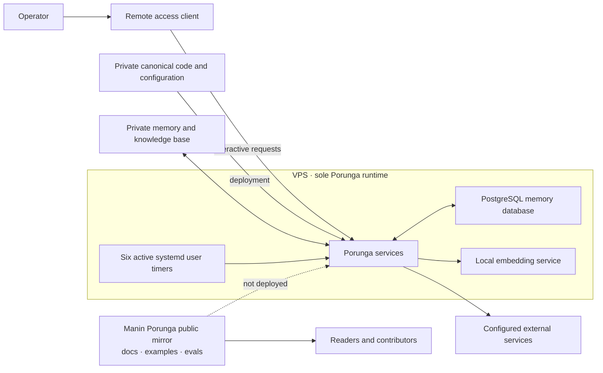

# Current Porunga architecture

> **Verified 2026-11-01.** Porunga runs on one VPS. This is the only Porunga
> execution host; no Porunga runtime component, hook, timer, persistent database,
> or runtime copy remains on the Mac. The public-facing term in this repository is **VPS**.

This page records the current production boundary without publishing provider
details, host identifiers, addresses, private filesystem paths, or credentials.

## Topology



The public repository is a curated mirror. Production code, runtime configuration,
private memory, and credentials remain outside it. A file or service example in
this repository does not establish that the item is installed or active on the VPS.

## Scheduled work

Six systemd user timers were active on the VPS during the 2026-11-01 check. They
cover these recurring tasks:

- Production health checks and actionable incident reports.
- Persistent memory database backups.
- Morning brief generation.
- Private knowledge-base index rebuilding.
- Runtime health checks and failed-step reporting.
- Private memory synchronization to its canonical archive.

## Persistent services

- The PostgreSQL memory database was active and accepting local connections during
  the 2026-11-01 check.
- The local embedding service was running on the VPS during the same check.
- The private knowledge base and runtime state are not included in this public
  repository.

## Source of truth

| Concern | Authority |
|---|---|
| Production code and deployment configuration | Private Porunga Git repository |
| Private memory and project knowledge | Private knowledge base |
| Production execution and scheduled work | VPS |
| Public examples, documentation, and eval fixtures | This repository |
| Selected machine-generated reports | Notion archive; never the code or doctrine authority |

## Operational checks

Run these on the VPS when checking live state:

```bash
systemctl --user list-timers --all
systemctl --user list-units --type=service --state=running
```

The source tree is not runtime evidence. Confirm the active unit and its recent
verdict before describing a routine as healthy.
