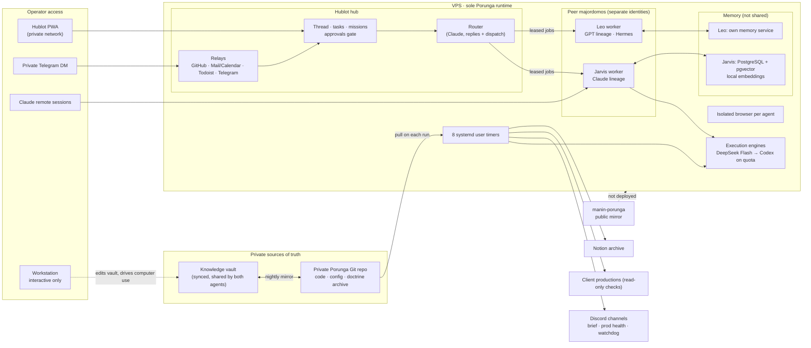

# Current Porunga architecture

> **Verified 2026-11-03** against the live scheduler and service manager, not against
> source files. Porunga runs on one VPS, its only execution host. The public-facing
> term in this repository is **VPS**; provider, host identity, addresses, ports,
> private paths, and credentials are omitted.

## What changed since the 2026-11-01 snapshot

| Area | Before | Now |
|---|---|---|
| Operator entry point | Remote terminal sessions | **Hublot**, a private PWA thread shared by the operator and both agents, plus a private Telegram DM bridged to the same conversation |
| Agents | One assistant on the VPS | **Two peer majordomos** on the same VPS with separate identities: Jarvis (Claude lineage) and Leo (GPT lineage, Hermes agent) |
| Execution engines | Claude ran scheduled work | **Claude orchestrates only.** Execution runs on DeepSeek Flash, falls back to Codex on quota exhaustion, never silently back to Claude |
| Notifications | Telegram | **Discord**, one channel per organ (brief, production health, runtime watchdog) |
| Scheduled work | Six user timers | **Eight** user timers (see below) |
| Memory recall | Lexical indexes only | Jarvis memory database with **pgvector** and a local multilingual embedding model, recalled on every prompt; Leo keeps a separate memory service |

## Topology



A static rendering of the same map lives in [`assets/setup-map.html`](assets/setup-map.html)
([PNG](assets/setup-map.png)).

## Hublot — the operator hub

Hublot is a private, self-hosted PWA (Node 22, PostgreSQL, no front-end build) that
replaces ad-hoc terminals as the main way to talk to the agents.

- **One thread, three participants.** The operator, Jarvis, and Leo post in the same
  feed. A Telegram DM is bridged into the same conversation, restricted to the owner's
  account; replies are queued in an outbox and only marked sent after delivery.
- **Router.** Incoming messages are answered or dispatched by a Router running on a
  mid-size Claude model. Messages sent while a turn is running are batched into one job.
- **Leased workers.** Each agent runs a worker that claims jobs under a lease; an
  expired lease is re-issued with a new token, so a stale worker cannot complete it.
- **Approval gate.** Agents never contact third parties directly: every external action
  tool requires a successful `claim_approval` on a human-approved draft.
- **Code sessions.** Each session starts from a fresh worktree off `origin`. Personal
  repositories are pushed and merged automatically; client and company repositories
  get a pushed branch and an open PR, and the merge stays with the operator.
- **Relays.** GitHub, mail/calendar, Todoist, and Telegram events enter through relays
  that filter on a proven sender before creating anything.

## Engine routing

| Work | Engine | Fallback |
|---|---|---|
| Replies to the operator, routing, reports | Claude (orchestration) | — |
| Scheduled routines, delegated tasks, code sessions | DeepSeek Flash | Codex, once, on HTTP 402/429 or exhausted balance |
| Memory extraction | DeepSeek Flash | Codex |
| Explicit operator override | Engine named by the operator | none |

A quota gate is checked before each run (prepaid balance floor for DeepSeek). A gate
that cannot be read counts as closed and the work is postponed, never re-routed to
Claude automatically. One scheduled render still calls Claude Code headless and is
listed below as a known exception. Deterministic organs (watchdog, index rebuild, sync, backup)
use no model at all.

## Scheduled work

Eight systemd user timers were active on the VPS during the 2026-11-03 check:

| Organ | Cadence (UTC) | Engine | Output |
|---|---|---|---|
| Production health (Watchtower) | daily 03:00 | deterministic; DeepSeek only for 🔴 reports | Discord, production-health channel |
| Memory database backup | daily ~03:15, randomized | `pg_dump` | local dump, verified |
| Morning brief | daily 03:30 | DeepSeek → Codex | Discord, brief channel |
| Knowledge-vault index rebuild | daily 03:30 and at boot | deterministic | structured index |
| Runtime watchdog | daily 04:45 | deterministic, no LLM | Discord, watchdog channel |
| Hublot watchdog | every 15 min | deterministic | Discord alert on stalled jobs or relays |
| Memory sync to Git archive | daily 19:30 | deterministic | private Git commit |
| Daily content render | daily 23:00 | headless Claude Code — known exception to the engine policy, pending migration | shared folder |

Every organ has a reader of its verdict — success, failure, absence, or delay. An
organ without a reader must report each failure itself; silent failure is not allowed.

## Persistent services

| Service | Role |
|---|---|
| Hublot server, Jarvis worker, Leo worker | Hub, job queue, and the two agents' executors |
| Hublot relays (GitHub, mail/calendar, Telegram, Todoist) | Inbound events, sender-filtered |
| PostgreSQL 17 + pgvector | Jarvis long-term memory (Hublot keeps its own PostgreSQL database) |
| Local embedding service | Multilingual embeddings on CPU for memory recall |
| Leo memory service | Leo's own memory; no shared bank with Jarvis |
| Hermes gateway | Leo's messaging integration |
| Claude remote control | Remote sessions from the mobile/web client |
| Per-agent browser on a virtual display | Real web sessions with isolated profiles, observable over VNC |
| File sync | Bidirectional sync of the knowledge vault with the workstation |

## The workstation

The workstation is a `secondary`, interactive client: knowledge-vault editing,
native-app computer use, a personal browser, and an IDE. It runs **no** Porunga
timer, hook-driven background organ, or persistent store.

## Source of truth

| Concern | Authority |
|---|---|
| Production code, deployment configuration, doctrine archive | Private Porunga Git repository |
| Doctrine editing and project knowledge | Private knowledge vault (mirrored nightly into Git) |
| Production execution and scheduled work | VPS |
| Agent coordination state | Hublot database |
| Episodic memory | Jarvis memory database — explicitly non-canonical |
| Selected machine-generated reports | Notion archive; never the code or doctrine authority |
| Public examples, documentation, and eval fixtures | This repository |

## Operational checks

Run these on the VPS when checking live state:

```bash
systemctl --user list-timers --all
systemctl --user list-units --type=service --state=running
systemctl list-units --type=service --state=running   # system-level helpers
```

The source tree is not runtime evidence. Confirm the active unit and its latest
verdict before describing a routine as healthy.
